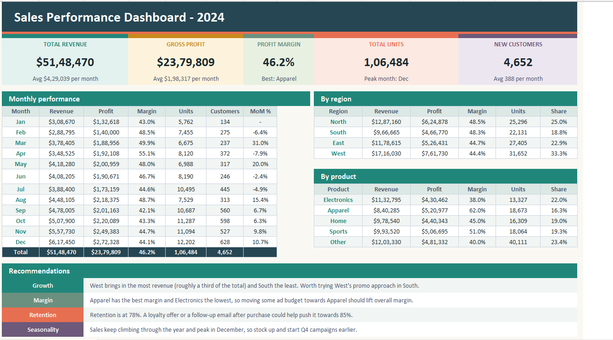
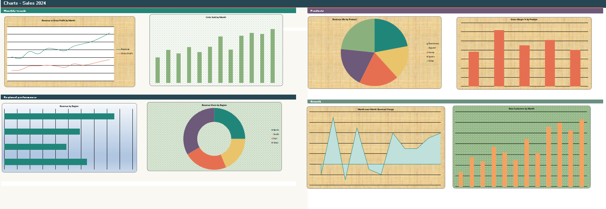

# Sales Performance Analysis Dashboard

An Excel dashboard to analyze sales trends, regional performance,
product-wise revenue, profit margins and marketing KPIs.

## What this project covers
- Monthly sales and profit trends
- Regional and product-wise performance
- Profit margin analysis
- Marketing KPIs (retention, CTR, CAC, ROAS, NPS)
- Recommendations to improve sales and customer engagement

## Tools used
- Microsoft Excel (formulas, SUMIF, charts)

## Sheets in the workbook
| Sheet | What it shows |
|-------|---------------|
| Dashboard | KPI cards, monthly, regional and product summary |
| Charts | All main charts in one place |
| Monthly Summary | Revenue, profit and month-over-month change |
| Regional | Region-wise revenue and margin |
| Products | Product-wise revenue and margin |
| Marketing KPIs | Marketing and business KPIs |
| Data | Source data |

## Screenshots

## Key insights
- West region brings in the most revenue
- Apparel has the highest margin, Electronics the lowest
- Sales peak in December, so Q4 planning should start earlier

## Note
The data used is sample data created for practice.

## Author
Manish Kumar
